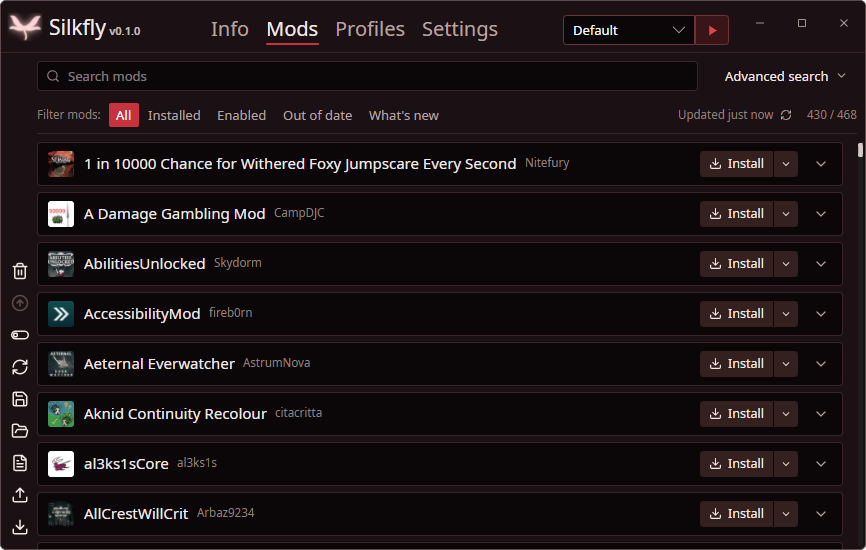
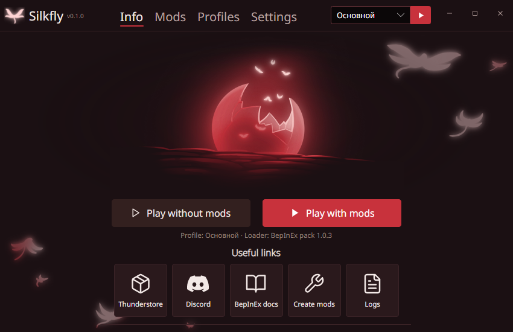

# Silkfly

A cross-platform mod manager for **Hollow Knight: Silksong**. Mods come from
[Thunderstore](https://thunderstore.io/c/hollow-knight-silksong/) and are loaded with
[BepInEx](https://github.com/BepInEx/BepInEx) through UnityDoorstop. Windows, Linux and macOS.

<p align="center">
  
  
</p>

## Features

- Browse, search and filter the Thunderstore catalog for Silksong; works offline from a cache.
- Install, update, enable/disable and remove mods with their dependencies, pick a specific version, drop in a .zip or .dll.
- **Profiles**: separate sets of mods and configs, switched instantly without reinstalling anything.
  Share them as `.r2z` files or Thunderstore profile codes.
- Play with or without mods in one click; Steam and Proton launch options are explained in the app.
- Russian and English interface.
- Silkfly updates itself from GitHub Releases.

## Installation

Download the latest version from [Releases](https://github.com/Ishmael-GameDev/Silkfly/releases/latest):

| System | File |
|---|---|
| Windows 10/11 (x64) | `Silkfly-Windows-Setup.exe`, or `Silkfly-Windows-Portable.zip` to run without installing |
| Linux (x64) | `Silkfly-Linux.AppImage`, make it executable (`chmod +x`) and run it |
| macOS (Apple Silicon) | `Silkfly-macOS-AppleSilicon.zip`, unzip and move Silkfly to Applications |
| macOS (Intel) | `Silkfly-macOS-Intel.zip`, unzip and move Silkfly to Applications |

On first start Silkfly finds the game (Steam, GOG or a folder you choose), installs the BepInEx loader into it
and creates a profile. The loader can be removed again in Settings; playing without mods works at any time.

## FAQ

**Windows says "Windows protected your PC".**
Silkfly is not code-signed yet, so SmartScreen warns about any new download. Click **More info → Run anyway**.
The installer and the source code come from this repository; you can also build Silkfly yourself (see below).

**macOS says Silkfly "cannot be opened" or "is damaged".**
The app is not notarized by Apple. Right-click Silkfly in Applications and choose **Open**, or run:

```bash
xattr -dr com.apple.quarantine /Applications/Silkfly.app
```

**The game hangs on a black screen with mods.**
Usually a mod does not support your game version. Start the game with **Play without mods** to check the game
itself, then disable mods in the profile one by one. The BepInEx log is in the profile folder (`BepInEx/LogOutput.log`).

**Where are my files?**
Settings and profiles: `%LOCALAPPDATA%\Silkfly` on Windows, `~/.local/share/Silkfly` on Linux,
`~/Library/Application Support/Silkfly` on macOS. The side bar of the Mods screen opens the mods and saves folders.

**I use another mod manager.**
Silkfly installs the loader into the game folder like other BepInEx managers do. If another tool has already put
BepInEx there, Silkfly warns you first and moves those files to `.silkfly-backup` in the game folder, so they can be restored.

## Building

Requires the .NET 10 SDK; Visual Studio 2026 or another IDE that supports .NET 10.

```bash
dotnet restore
dotnet build
dotnet test
dotnet run --project src/Silkfly.App
```

Tests that talk to the real Thunderstore (download the catalog and install a small mod into a temporary profile)
are skipped unless `SILKFLY_ONLINE_TESTS=1` is set.

Or open `Silkfly.sln` in Visual Studio and run the `Silkfly.App` project. How releases are made: [docs/releasing.md](docs/releasing.md).

## Credits

- [Thunderstore](https://thunderstore.io): mod catalog
- [BepInEx](https://github.com/BepInEx/BepInEx) and [UnityDoorstop](https://github.com/NeighTools/UnityDoorstop): mod loading
- [Avalonia UI](https://avaloniaui.net), [CommunityToolkit.Mvvm](https://github.com/CommunityToolkit/dotnet), [Serilog](https://serilog.net)
- [Velopack](https://velopack.io): installers and updates
- Icons: [Lucide](https://lucide.dev) (ISC), Discord logo from [Simple Icons](https://simpleicons.org) (CC0)
- UI design inspired by [Lumafly](https://github.com/TheMulhima/Lumafly)
- Silk fly art and the illustration: Hollow Knight: Silksong by [Team Cherry](https://www.teamcherry.com.au)

See [THIRD-PARTY-NOTICES.md](THIRD-PARTY-NOTICES.md) for licenses.

## License

Silkfly is free software under the [GNU General Public License v3.0](LICENSE).
The Hollow Knight: Silksong artwork (`src/Silkfly.App/Assets/Art`, the app icon in `src/Silkfly.App/Assets/silkfly.ico`
and `build/icons`) belongs to Team Cherry and is not covered by this license (see THIRD-PARTY-NOTICES.md).

Silkfly is a fan project and is not affiliated with Team Cherry.
